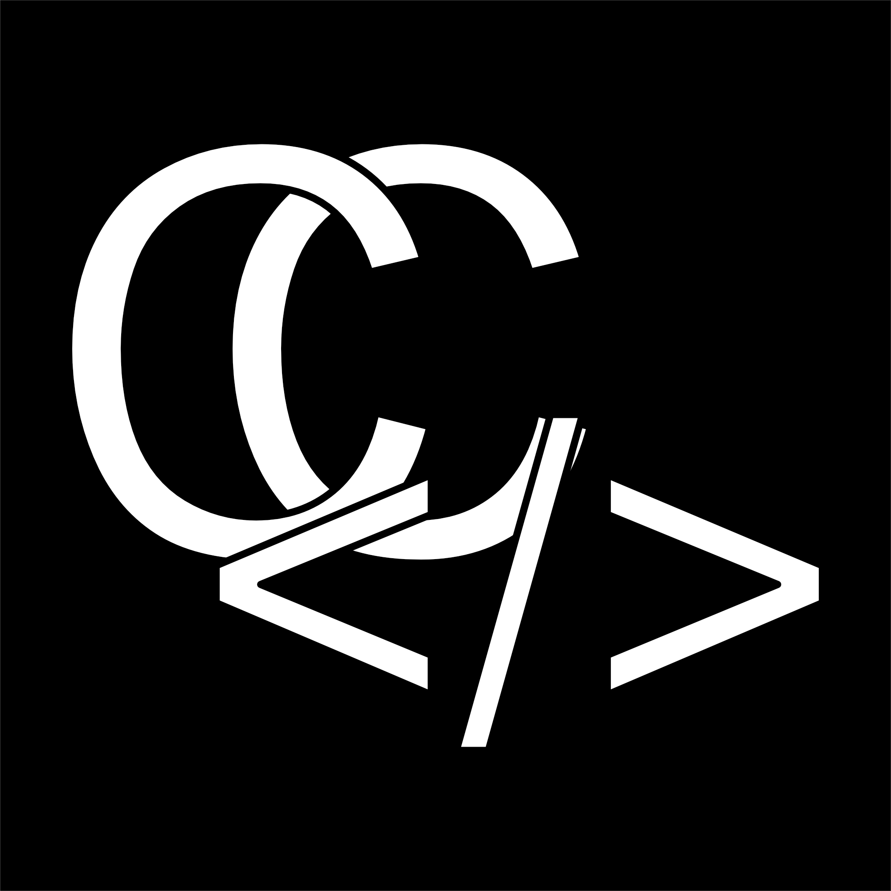

# CCPL for Visual Studio Code

<p align="center"></p>

Syntax highlighting and editor support for **CCPL**, the *Cool Compilable
Programming Language*. CCPL is a Lua flavored language that compiles to native
programs through TinyCC.

This repository contains only the VS Code extension. The language implementation
lives in the compiler repository.

## Contents

* [Features](#features)
* [Install](#install)
* [A taste of CCPL](#a-taste-of-ccpl)
* [Related repositories](#related-repositories)
* [Contributing](#contributing)
* [License](#license)

## Features

* Syntax highlighting for `.ccpl` files
* Keywords and control flow: `if`, `elseif`, `else`, `while`, `repeat`,
  `until`, `for`, `return`, `break`, and `continue`
* Declarations: `var`, `variable`, `func`, and `get`
* Foreign declarations: `extern`, `from`, and `as`
* Builtins: `say`, `hey`, `oh`, `tonumber`, `tostring`, `malloc`, `calloc`,
  `realloc`, `free`, `pyexec`, and `pyeval`
* Native types: `i8` to `i64`, `u8` to `u64`, `f32`, `f64`, `bool`, `char`,
  `ptr`, and `cstr`
* Numbers: decimal, float, exponent, and hexadecimal
* Strings with named escapes and decimal escapes
* Line comments with `--` and block comments with `--[[` and `]]`
* Smart bracket and quote pairing
* A custom icon and a dark gallery banner

## Install

### From the Marketplace

Search for **CCPL** in the VS Code Extensions view, or run:

```sh
code --install-extension ccpl.ccpl
```

### From a `.vsix`

```sh
code --install-extension ccpl-0.4.0.vsix
```

### From source

```sh
git clone https://github.com/ccpl-lang/vscode-ccpl.git
cd vscode-ccpl
npm install
npx vsce package
code --install-extension ccpl-0.4.0.vsix
```

## A taste of CCPL

```ccpl
say("hello, world")

func add(a: i32, b: i32): i32
    return a + b
end

for i = 1, 3 do
    say("add", i, add(i, 10))
end
```

Foreign functions look like this:

```ccpl
extern "c" func strlen(s: cstr): u64 from "msvcrt.dll"
extern "python" func sqrt(x: f64): f64 from "math"

say(strlen("hello"), sqrt(2.0))
```

## Related repositories

* [ccpl](https://github.com/ccpl-lang/ccpl) is the compiler and language
  implementation, under GPL v3.
* [the toolchain repository](https://github.com/ccpl-lang/ccpl-toolchain) is a
  ready to run Windows bundle, under GPL v3.
* [this extension](https://github.com/ccpl-lang/vscode-ccpl) is released under
  MIT.

## Contributing

Issues and pull requests are welcome. Please open an issue before starting a
larger change. To change highlighting, edit `syntaxes/ccpl.tmLanguage.json` and
test with the `Developer: Inspect Editor Tokens and Scopes` command.

## License

Released under the MIT License. See `LICENSE`.